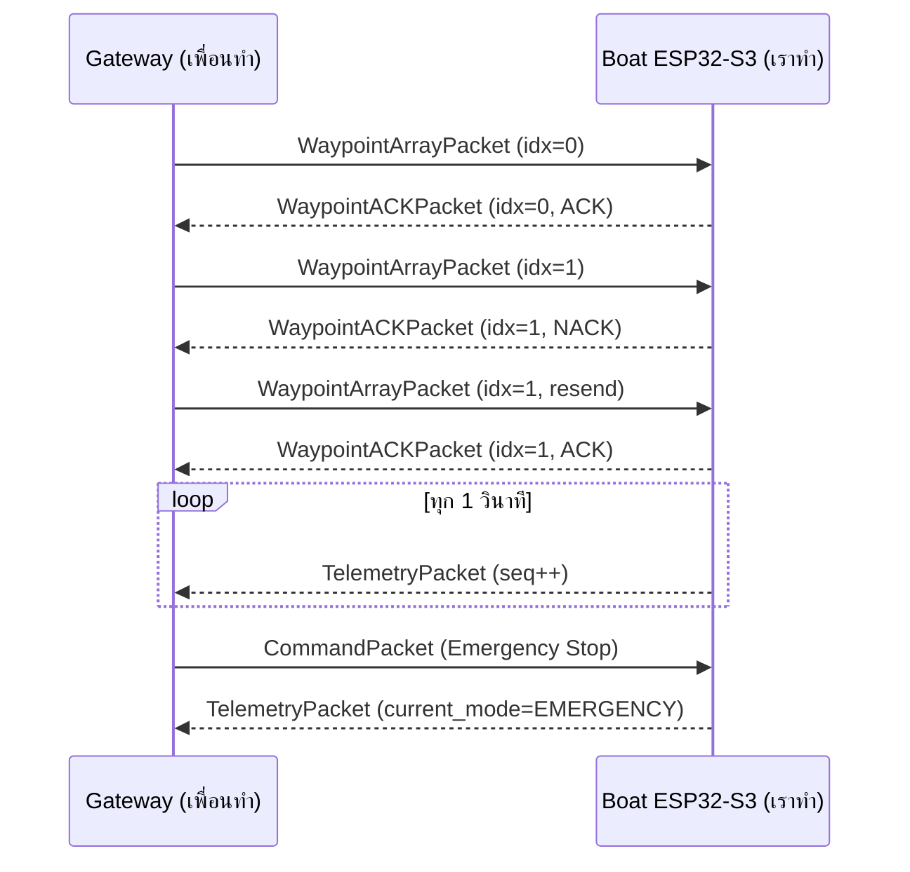

# ESP-NOW Interface Contract (Boat ↔ Gateway)

เอกสารนี้คือ "สัญญาการเชื่อมต่อ" ระหว่าง **บอร์ดเรือ (boat-side, โปรเจกต์นี้)** กับ
**บอร์ด/แอปฝั่งชายฝั่ง (gateway/shore-side, เพื่อนเป็นผู้ทำ)**
เฟิร์มแวร์เรือ implement เฉพาะครึ่งฝั่งเรือ ฝั่ง gateway ต้อง **mirror** ทุกข้อด้านล่างให้ตรงเป๊ะ

> Source of truth ของรูปแบบข้อมูลคือไฟล์ **`1_Firmware/include/Packets.h`** — ให้ฝั่ง gateway
> `#include` ไฟล์เดียวกันนี้ (คัดลอกไปแบบ verbatim) ห้ามพิมพ์ struct ใหม่เอง

---

## 1. ชั้นวิทยุและการจับคู่ (Radio & Pairing)

| พารามิเตอร์ | ค่า | หมายเหตุ |
| ----------- | --- | -------- |
| Wi-Fi mode | `WIFI_STA` | ทั้งสองบอร์ด |
| Wi-Fi channel | **1** (ล็อกตายตัว) | `esp_wifi_set_channel(1, WIFI_SECOND_CHAN_NONE)` ต้องตรงกัน |
| Long-Range (LR) | **เปิดทั้งคู่** | `WIFI_PROTOCOL_LR` — ถ้าเปิดข้างเดียวจะคุยกันไม่ได้ |
| Encryption | CCMP (ESP-NOW encrypt) | ต้องใช้ `PMK` + `LMK` ชุดเดียวกัน |
| Peer | MAC ของอีกฝั่ง (จับคู่ล่วงหน้า) | เรือเก็บ MAC gateway, gateway เก็บ MAC เรือ |

**ต้องตกลงร่วมกันก่อนใช้งาน (ยังเป็น placeholder ในโค้ด):**

- `PMK` (16 ไบต์) — ปัจจุบันในโค้ดเรือคือ `"USV_PMK_16bytes!"`
- `LMK` (16 ไบต์) — ปัจจุบันคือ `"USV_LMK_16bytes!"`
- MAC ของบอร์ดเรือ และ MAC ของบอร์ด gateway (แลกกันแล้ว hardcode)

> ในโค้ดเรือ ค่าเหล่านี้อยู่ที่หัวไฟล์ `src/comms/EspNowLink.cpp` และ `ESPNOW_WIFI_CHANNEL`
> ใน `include/config.h` — เปลี่ยนให้ตรงกับที่ตกลง แล้วแจ้งฝั่ง gateway ใช้ค่าเดียวกัน

---

## 2. ทิศทางและชนิดแพ็กเกจ

การ demux ฝั่งเรือใช้ **ขนาดของแพ็กเกจ** (แต่ละชนิดขนาดไม่ซ้ำกัน และถูกยืนยันด้วย `static_assert`)

### 2.1 Gateway → Boat (เรือรับ)

| แพ็กเกจ | ขนาด | ความถี่ | ต้องการ ACK |
| ------- | ---- | ------- | ----------- |
| `CommandPacket` | 5 B | ตามเหตุการณ์ | คำสั่งฉุกเฉินควรยืนยันผ่าน telemetry |
| `WaypointArrayPacket` | 194 B | ตอนตั้ง mission (ส่งเป็น batch) | **ใช่** (`WaypointACKPacket`) |

### 2.2 Boat → Gateway (เรือส่ง)

| แพ็กเกจ | ขนาด | ความถี่ |
| ------- | ---- | ------- |
| `TelemetryPacket` | 38 B | ทุก 1 วินาที (best-effort) |
| `WaypointACKPacket` | 2 B | ต่อ 1 batch ที่รับ |
| `BatteryReportPacket` | 20 B | ~ทุก 5 นาที (optional) |

รูปแบบไบต์: **little-endian, `__attribute__((packed))`** ตาม `Packets.h`

---

## 3. โครงสร้างข้อมูล (ย่อจาก Packets.h)

```c
typedef struct __attribute__((packed)) {
    uint8_t sys_command;    // 0=Normal, 1=Emergency Stop, 2=Force RTH
    int16_t manual_steer;   // -255..255
    int16_t manual_speed;   // -255..255
} CommandPacket;            // 5 bytes

typedef struct __attribute__((packed)) { double lat; double lon; } Waypoint; // 16 bytes

typedef struct __attribute__((packed)) {
    uint8_t  packet_index;
    uint8_t  waypoint_count;   // <= 12
    Waypoint waypoints[12];
} WaypointArrayPacket;         // 194 bytes

typedef struct __attribute__((packed)) {
    uint8_t packet_index;
    uint8_t ack_status;        // 0=ACK, 1=NACK
} WaypointACKPacket;           // 2 bytes

typedef struct __attribute__((packed)) {
    uint32_t sequence_number;
    double   gps_lat, gps_lon;
    float    water_ph, water_turbidity, water_temp;
    uint8_t  current_mode;     // 0=STANDBY,1=GRID,2=SPIRAL,3=RTH,4=EMERGENCY
    uint8_t  battery_percent;
    float    heading_angle;
} TelemetryPacket;             // 38 bytes
```

---

## 4. ความน่าเชื่อถือและความปลอดภัย

- **Waypoint batching**: gateway ส่งทีละ batch พร้อม `packet_index` เรือตอบ `WaypointACKPacket`
  ด้วย index เดียวกัน `ack_status=0` (ACK) หรือ `1` (NACK) ถ้า NACK หรือไม่ตอบภายใน timeout
  ให้ gateway **ส่งซ้ำ** batch นั้น
- **sequence_number** ใน telemetry เพิ่มขึ้นเรื่อย ๆ ฝั่ง gateway ควรทิ้งแพ็กเกจที่ `seq <=` ตัวก่อนหน้า
  (กัน replay) — ฝั่งเรือ stamp ค่านี้ให้อัตโนมัติ
- **Emergency (`CMD_EMERGENCY_STOP` / `CMD_FORCE_RTH`)**: เรือจะยืนยันผ่าน `current_mode`
  ใน telemetry ถัดไป (เช่นเปลี่ยนเป็น `4=EMERGENCY`) gateway ควรส่งซ้ำจนเห็นการยืนยัน
- แพ็กเกจที่ขนาดไม่ตรง contract จะถูกทิ้ง (นับใน `droppedPackets`)

---

## 5. ลำดับการทำงานตัวอย่าง



---

## 6. ขอบเขต

- **เราทำ (boat-side):** init/lock channel/LR/peer/encryption, รับ inbound → queue, ส่ง outbound,
  จัดการ seq/ACK ฝั่งเรือ (`src/comms/EspNowLink.*`)
- **เพื่อนทำ (gateway-side):** บอร์ด/แอปที่ส่ง command + waypoints และรับ telemetry + ACK
  — ไม่อยู่ใน scope การเขียนโค้ดของโปรเจกต์นี้
- **ส่งมอบให้เพื่อน:** ไฟล์ `include/Packets.h` + เอกสารฉบับนี้ + ค่า channel/PMK/LMK/MAC ที่ตกลงกัน
